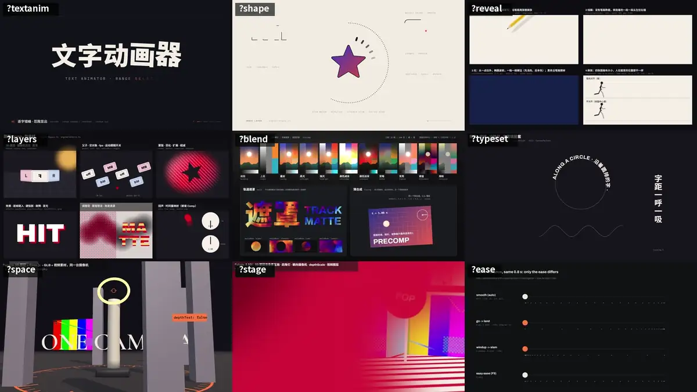
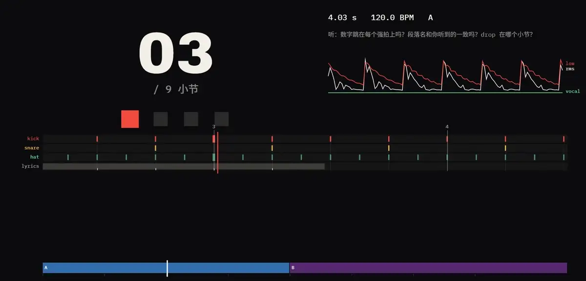
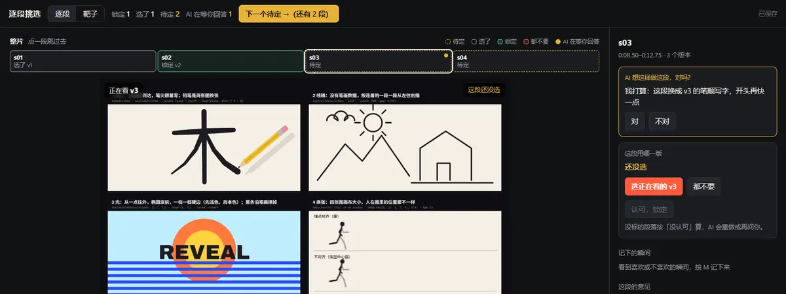
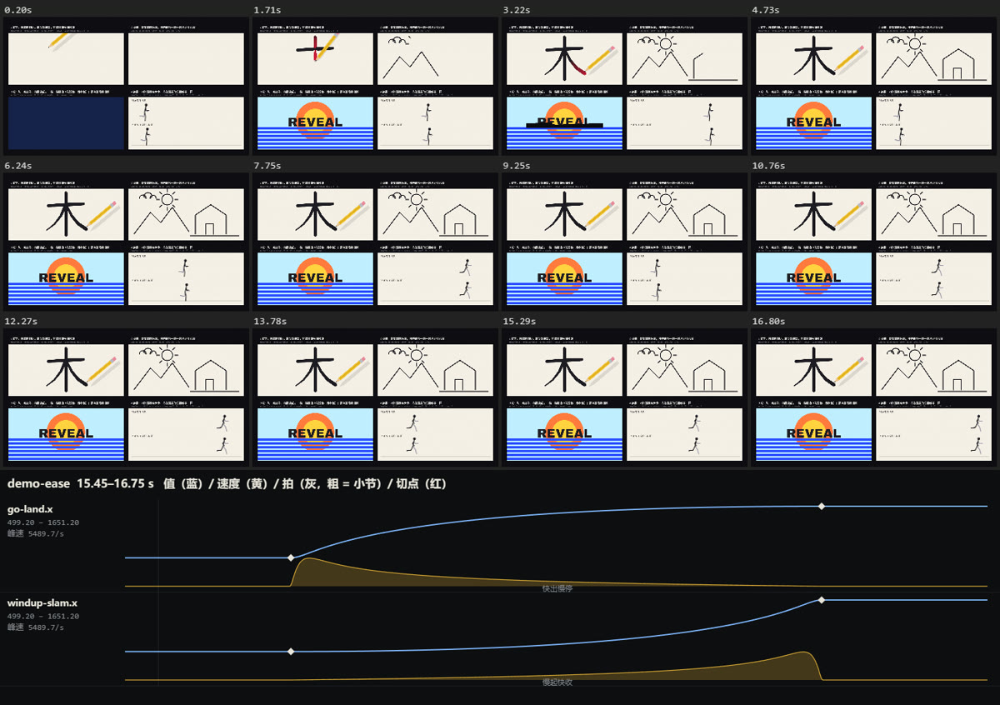
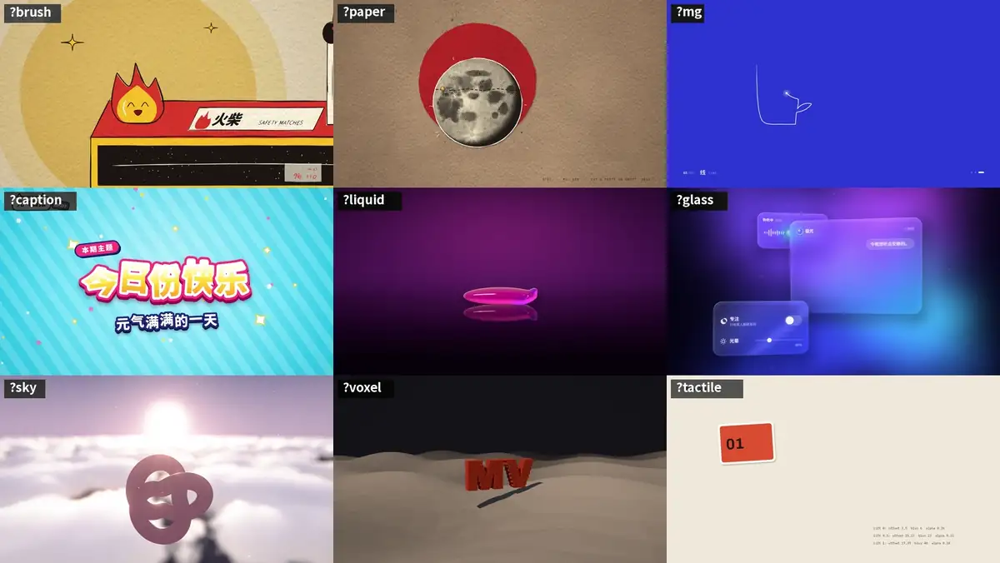

<div align="center">

# AGENT视频基础引擎

**画面交给模型，流程交给引擎。**<br>
给 AI Agent 做音乐视频用的底座：听歌、逐帧出片、留版本、检查、交付，少返工、少花 token。

*The model designs the picture; the engine is its organs — it hears the song, exports frame-exact, keeps every version and checks the cut.*

[](NOTICE.md)


[快速开始](#快速开始) · [示例提示词](#示例提示词) · [引擎做什么](#引擎做什么) · [效果展示](#画面用什么技术都行) · [做片指南](docs/做片指南.md) · [能力地图](docs/README.md)



</div>

<br>

现在的模型自己就能写出好看的画面。难的是画面之外：需求说不清、听不到歌、导出掉帧、改一版盖掉上一版、会话一长就忘。这些事每次让模型从头摸索，既费 token 又容易返工。引擎把它们做成现成的流程。

## 快速开始

需要 Python、[ffmpeg](https://ffmpeg.org)、[bun](https://bun.sh)、Edge 或 Chrome，以及一个 Agent（比如 [Claude Code](https://claude.com/claude-code)）。

```bash
git clone https://github.com/xiaoming6680/xm-video-engine.git 引擎
python 引擎/tools/new_project.py 我的新MV app
cd 我的新MV && python ../引擎/analysis/run.py 歌.flac
```

然后在 `我的新MV` 里打开 Agent，把下面任意一段提示词改改发过去。说不清也没关系，它会一步步问你。

## 示例提示词

把【】里的换成你自己的。歌词不用贴进对话，引擎会从音频里读。

**1. 从零开始，方向交给 Agent**

```text
用 AGENT视频基础引擎给【歌名】做一支 MV。歌在 audio/【歌.flac】，用【整首 / 0:45–1:30 这一段】。
横屏 16:9，发 B 站。我想要【一种感觉，比如：深夜一个人骑车回家，孤独但不丧】。
预算【正常发布的水准，别查论文，评审一轮就行 / 冲奖，副歌那段可以多花，评审打到 8.5 分以上】。
画面方向你来定：先分析歌，出分析确认片和歌词确认片给我听；
对上以后给我两三个不同的方向，每个一句话加一张静帧，我挑一个再往下做。
每一步做完给我看，我点头了再继续，别一口气做完整片。
加油，我们可以做到一切
```

**2. 我来定方向和几幕，你照着做**

```text
用 AGENT视频基础引擎给【歌名】做 MV，竖屏 9:16，发抖音，用副歌那段。
大方向：【纸片拼贴风的城市，一张张剪报被风吹起来，拼成主角回家的路】。
我想要这几幕：
1. 【前奏】桌上一叠旧报纸，第一张被风掀起
2. 【主歌】纸片在空中拼出街道，主角的剪影走在上面
3. 【副歌 drop】所有纸片同时炸开，重新落成一座发光的城
4. 【结尾】最后一张纸落回桌上，停住
先把第 3 幕做出来给我看，认可了再铺开其他几幕。卡点卡大落点就行，不用每拍都动。
加油，我们可以做到一切
```

**3. 照着参考片做**

```text
参考片在 refs/【参考.mp4】，我要的是它【0:12–0:20 的转场节奏和字的出场方式】，不要它的配色。
先放进挑选页让我对一遍你理解得对不对，再在我的歌【第 2 段】上做一版。
加油，我们可以做到一切
```

**4. 改一版**

```text
第 6–9 秒：标题和图标挤在一起，让图标先进来，标题后出。
第 12 秒：镜头太近，主角右边被切掉了，拉远一点。
结尾：字停得太短，我还没读完。
其他段落我满意，锁住别动，只改这三处，改完收成新版本放进挑选页。
加油，我们可以做到一切
```

**5. 交付**

```text
跑一遍交付自检。有技术问题直接修，动到画面口味的先问我。
然后出正式版、抖音版和封面（封面主文案：【……】），CREDITS 写清用到的引擎、字体、开源代码和素材。
加油，我们可以做到一切
```

更多说法和每一步要看什么，见[做片指南](docs/做片指南.md)。

## 引擎做什么

把它想成模型的器官：

| 器官 | 做什么 |
|---|---|
| 嘴：开工引导 | 需求说不清时和人一步步确认：预算和目标（要到什么水准）、歌和范围、方向谁来定、大方向和参考、想要的几幕，每步给具体的东西看 |
| 耳朵：分析歌 | 节拍、段落、鼓点、逐词歌词（中日韩英），再出确认片给人听一遍 |
| 手：逐帧出片 | 任意时刻都能准确画出来，帧数精确、音画对齐；正式版、抖音版、封面 |
| 记性：版本 | 每一版都留着，人逐段挑、锁定，只重做没认可的部分 |
| 眼睛：检查 | 抽帧表、关键帧曲线、洋葱皮、卡点偏差、音量峰值、闪光 |

画面方向可以你来定（大方向和想要的几幕，Agent 照着做），也可以全交给 Agent，让它出几个方向给你挑。

### 分析歌，先听一遍确认

大数字踩在每个强拍上，标着鼓点、人声和段落。拍子和 drop 对上了再往下做，后面的卡点都靠它。



### 每一版都留着，逐段挑

几版并列在同一个时钟上播，点哪版就选哪版，认可的段落锁住。Agent 想改方向时先在这里问一句，你点“对 / 不对”。



### 看得见动起来的样子

模型看不了视频，引擎把动作变成图：抽帧表看节奏，关键帧曲线看是“快出慢停”还是在飘。



## 画面：用什么技术都行

Canvas、SVG、three.js、着色器、Blender、生图、实拍都行，[能力地图](docs/README.md)里有“什么效果适合什么技术”的对照。引擎自带两套可选的东西，Agent 自己写得更好就不用：

- **AE 式零件**：图层、关键帧和曲线编辑器、文字动画器、形状层、混合模式和遮罩、统一摄像机、2.5D 舞台（最上面那张图）；效果栈（扭曲、转场、翻页、卡片擦除、调色、图层样式、抠像、光、操控点、碎裂）、粒子、灯光和投影、路径运算、运动路径；素材的跟踪、稳定、3D 摄像机反求、Roto、光流变速（`tools/`）
- **效果库**：手绘、拼贴、MG、花字、液态、玻璃、云海、体素、实物感等，还有 200 个 WebGPU 着色器（下图）



在 `app` 里跑 `bunx vite`，网址后面加 `?textanim`、`?space`、`?paper` 这样的参数就能看每个示例。

## 文档

| 文档 | 给谁 | 讲什么 |
|---|---|---|
| [做片指南](docs/做片指南.md) | 人 | 从一首歌到成片，每一步怎么说、看什么 |
| [能力地图](docs/README.md) | Agent | 开工引导、省 token 的做法、流程工具、效果和技术栈对照 |
| [场景渲染](docs/场景渲染.md) | Agent | `app/` 渲染器和可选的 AE 式零件怎么用 |
| [检查和评审](docs/检查和评审.md) | Agent | 交付自检、看片工具、独立评审 |

## 许可和致谢

本项目自己的代码和文档按 [GPL-3.0-or-later](LICENSE) 发布；第三方部分保留各自的 MIT 许可，哪部分用哪个许可见 [NOTICE.md](NOTICE.md)。

- 引擎核心来自 [mexicat/pdoom-video](https://github.com/mexicat/pdoom-video)（Giacomo Magnanini，MIT）
- `app/src/library/vendor/shaders/` 来自 [shader-effects-inc/shaders](https://github.com/shader-effects-inc/shaders)（MIT）
- 部分效果和配乐音效库 `tools/audio/mgaudio` 照 [Vincentwei1021/mg-styles-15](https://github.com/Vincentwei1021/mg-styles-15)（MIT）重写或收录；乐器采样来自 VCSL（CC0）
- 几段效果练习参考了 B 站《当 (•ω•) 被运行之后……》和 [guiguisocute/bad-time-mv](https://github.com/guiguisocute/bad-time-mv) 的画面手法，代码是重写的
- 字体为 OFL，纸纹贴图为 CC0；`audio/`、`data/` 里是脚本合成的测试曲，不含任何歌曲；其他参考过的开源仓库见 [third_party/README.md](third_party/README.md)
