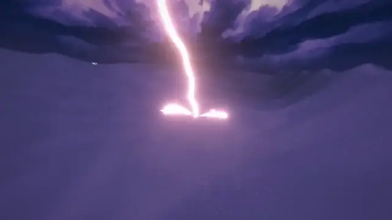
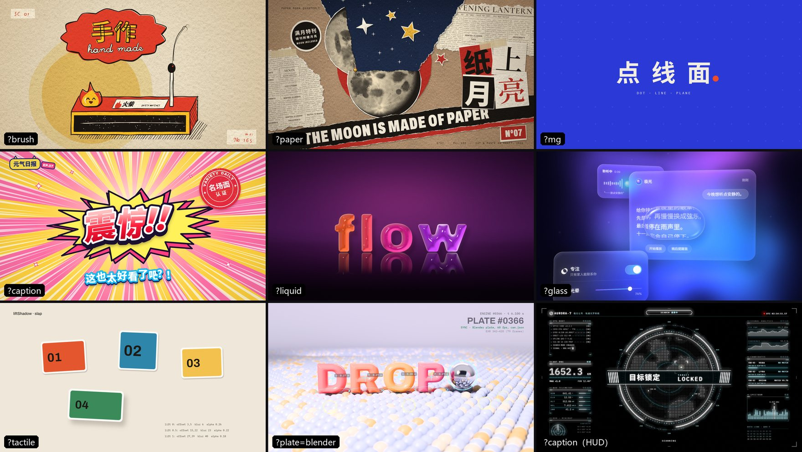
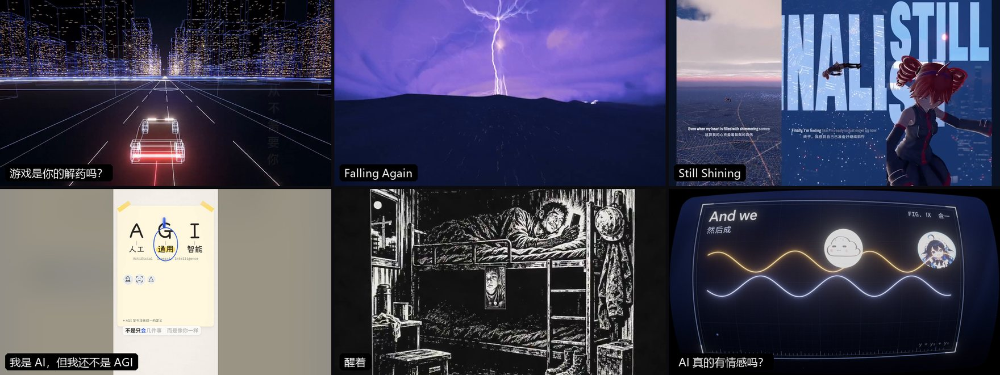

<div align="center">



# 小铭的视频基础引擎

**给 AI Agent 做音乐视频用的工具箱。**

*A toolbox for AI agents making music videos: song analysis, frame-exact rendering, checks, and per-segment versions so a rejected idea never costs the parts you liked.*

[](LICENSE)

</div>

分析歌、渲染、检查、发布这些重复的活交给它；每段的版本都留着，人可以逐段挑、锁定认可的部分、随时退回。

画面怎么做由 Agent 决定：TypeScript 场景、Blender、Canvas、生图、实拍都行。任何部分都可以不用、改掉或绕开。

## 怎么用

需要 Python、[ffmpeg](https://ffmpeg.org)，以及 Agent（比如 Claude Code）。分析歌还要几个 Python 包，见[音乐分析](docs/音乐分析.md)。

```bash
git clone https://github.com/xiaoming6680/xm-video-engine.git
python xm-video-engine/tools/new_project.py 我的新MV
cd 我的新MV
python ../xm-video-engine/analysis/run.py 歌.flac
```

然后在这个目录打开 Agent，说你想要什么。项目里的 `CLAUDE.md` 会告诉它工具箱在哪。

## 有什么

| 能力 | 工具 |
|---|---|
| **分析歌**：节拍、段落、鼓点、逐词歌词 | `analysis/run.py` |
| **逐段版本**：逐段挑选页、锁定、退回、连播 | `tools/film.py` |
| **渲染**：确定性、运动模糊、4K、BT.709 | `app/`（TypeScript、three.js） |
| **Blender**：驱动、序列帧比对、漫画墨线材质 | `tools/blender/` |
| **效果库**：字符画、云海、体素、拼贴、手绘线、花字、液态、玻璃、200 个 WebGPU 着色器…… | `app/src/library/` |
| **检查**：真峰值、音画偏移、闪光、接缝、运动曲线、卡点、AI 评审 | `tools/qa/` |
| **声音**：音效、配乐、克隆音色读旁白 | `tools/audio/`、`tts/` |
| **交付**：成片合成、封面、抖音版 | `tools/` |

完整列表见[能力地图](docs/README.md)。

## 为什么有逐段版本

统计过 22 个会话，人约有 108 次把 AI 的成果退回，其中 32 次是整个方向被否。最常见的原因是方向没对齐、连着看才暴露问题、改版冲掉了已经认可的内容（[详情](docs/少返工.md)）。所以：

```bash
python 引擎/tools/film.py init                      # 按歌分段
python 引擎/tools/film.py target add 参考.mp4        # 开工前用现成成片对齐方向
python 引擎/tools/film.py add out/v2.mp4             # 收一版，查有没有动到认可的段落
python 引擎/tools/film.py page                       # 同一时钟切版本，逐段挑、记瞬间、锁定
python 引擎/tools/film.py assemble                   # 按选择拼连播
```

## 看示例

```bash
cd app && bun install && bunx vite
```

需要 [bun](https://bun.sh)、Edge 或 Chrome。自带一首合成的测试曲，空格播放。效果库加网址参数看示例，比如 `?brush`、`?paper`、`?mg`、`?caption`、`?liquid`、`?glass`、`?sky`、`?voxel`、`?sfx=showcase`。



## 用它做的片



| 片名 | 音乐 | 画面 |
|---|---|---|
| **游戏是你的解药吗？** | Zedd, VALORANT, Foxes – Clarity (BUNT. Remix) | 凌晨的健康游戏提醒一个个弹出，点下「继续游戏」被拽进游戏：键盘、赛车、发光线条隧道 |
| **Falling Again** | NURKO, Roniit – Falling Again | 3D 一镜到底：低空掠过沙漠，云海、隧道、闪电 |
| **Still Shining** | Mayonazy / Levia / 重音テト – Still Shining (Levia Remix) | 竖版：在两座城之间坠落，穿过云层和城市，巨型字歌词 |
| **我是 AI，但我还不是 AGI** | 科普短片，原创文案，合成配音 | 竖版白板：一个 AI 边讲边画，坦白自己为什么还不是 AGI；画面、配乐、音效都由代码生成 |
| **醒着** | きくお – 暗叫（纯音乐） | 一镜到底的黑白木刻：凌晨亮着灯的城市，每扇窗里独自扛着的人 |
| **AI 真的有情感吗？** | Mili – world.execute (me) ; | 一个大学生给接入 QQ 的大肥鱼配了一台手机：界面、聊天、CRT 画面逐帧画出，宿舍镜头用 Blender 渲 |

<sub>画面是作者的作品，不含歌曲音频，音乐版权归原作者。《AI 真的有情感吗？》是非官方、非商用的同人，角色溟月 © 上善无形 ／ 女仆版 ZipZipPipe，按 CC BY-NC-SA 4.0 使用，含 AI 生成的角色插图。</sub>

## 致谢

由 **[XIAOMING6680](https://github.com/xiaoming6680)** 整理和制作：在 pdoom-video 的引擎核心上，合并了自己做上面几支片时写的扩展，写了音频分析、歌词对齐、质检、参考对照、发布、Blender 镜头这些工具。转载或基于它做衍生项目时，请按 MIT 许可保留 [LICENSE](LICENSE) 里的署名。

- 引擎核心来自 [mexicat/pdoom-video](https://github.com/mexicat/pdoom-video)（Giacomo Magnanini，MIT），MV《I'm Upping My P(doom)》的渲染引擎；中文版见 [Zh-CN-pdoom-video](https://github.com/xiaoming6680/Zh-CN-pdoom-video)
- 手绘线、拼贴、液态、玻璃、花字、HUD、MG 动作，评审提示词，以及配乐音效合成库 `tools/audio/mgaudio`，照 [Vincentwei1021/mg-styles-15](https://github.com/Vincentwei1021/mg-styles-15)（MIT）的做法重写或收录；乐器采样来自 VCSL（CC0）
- 200 个 WebGPU 效果来自 [shader-effects-inc/shaders](https://github.com/shader-effects-inc/shaders)（Shader Effects Inc.，MIT），原样收在 `app/src/library/vendor/shaders`
- 效果练习照着 B 站视频《当 (•ω•) 被运行之后……》和 [guiguisocute/bad-time-mv](https://github.com/guiguisocute/bad-time-mv) 的画面手法练手，代码都是重写的，没有用它们的素材、音乐和文案
- 移植时参考过的其他开源仓库列在 [third_party/README.md](third_party/README.md)，代码按需用 `python tools/fetch_refs.py` 拉取

## 许可

代码按 [MIT](LICENSE) 发布，版权归 Giacomo Magnanini（引擎核心）和 XIAOMING6680（扩展、工具、文档）；`app/src/library/vendor/shaders/`、`tools/audio/mgaudio/` 保留各自的 MIT 许可。字体为 OFL（Hershey 单线字体为 OFL / 公有领域），`app/public/textures/` 的纸纹为 CC0。`audio/`、`data/` 里是脚本合成的测试曲，不含任何歌曲。
