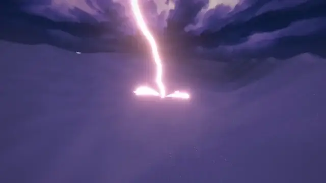
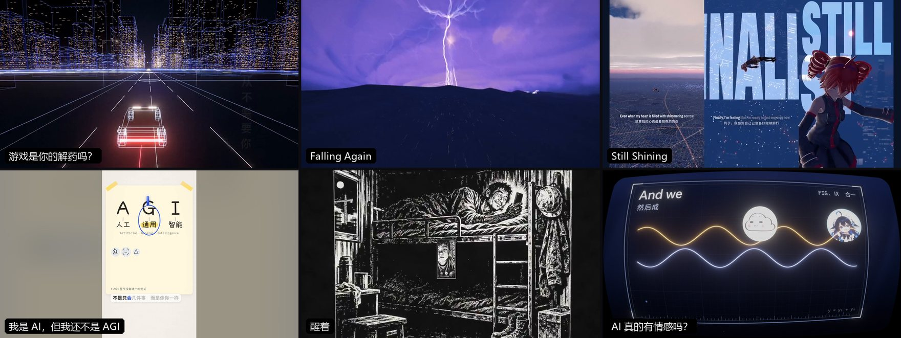
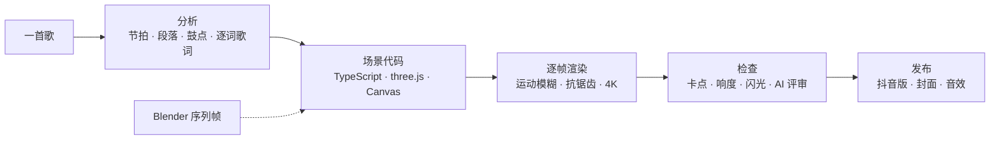
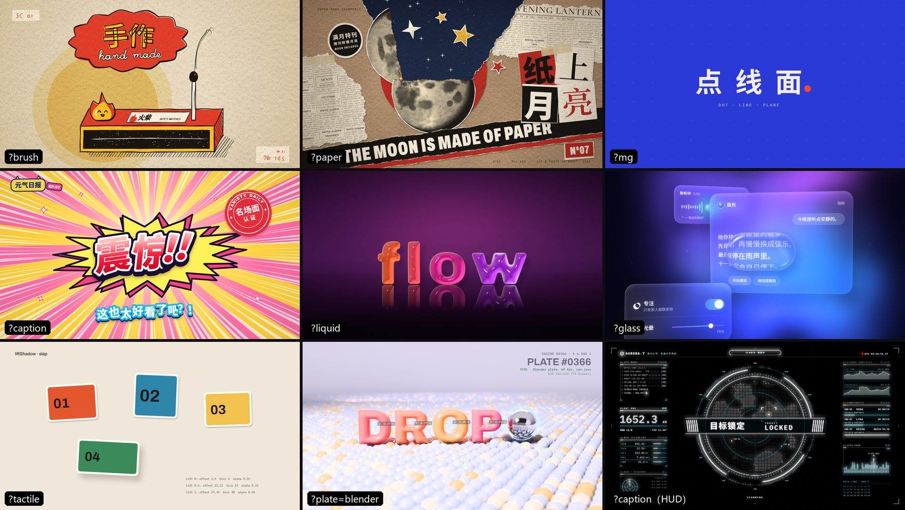

<div align="center">



# 小铭的视频基础引擎

**用代码一帧一帧画出音乐视频。**

*A code-driven music video engine: analyse a song, write scenes in TypeScript, render frame-exact 4K video.*

[](LICENSE)    

[用它做的片](#用它做的片) · [特性](#特性) · [怎么工作](#怎么工作) · [快速开始](#快速开始) · [做一支片](#做一支自己的片) · [效果库](#效果库) · [和 AI 一起做](#和-ai-一起做) · [文档](#文档)

</div>

给它一首歌，它分析出每一拍、每个小节、每一下鼓点和每个词的起止时间；你用 TypeScript 写场景，画面就跟着音乐走。每一帧都是 three.js、Canvas 2D 和着色器当场画出来的，不用视频生成模型，也不用素材视频，所以能卡到每一拍，任意一帧都能单独重渲和修改，导出带运动模糊的 4K。

画风、镜头、叙事由你（或你的 AI 助手）来定；音乐分析、渲染、检查、发布这些重复的活交给引擎。

## 用它做的片



| 片名 | 音乐 | 画面 |
|---|---|---|
| **游戏是你的解药吗？** | Zedd, VALORANT, Foxes – Clarity (BUNT. Remix) | 凌晨的健康游戏提醒一个个弹出，点下「继续游戏」被拽进游戏：键盘、赛车、发光线条隧道 |
| **Falling Again** | NURKO, Roniit – Falling Again | 3D 一镜到底：低空掠过沙漠，云海、隧道、闪电 |
| **Still Shining** | Mayonazy / Levia / 重音テト – Still Shining (Levia Remix) | 竖版：在两座城之间坠落，穿过云层和城市，巨型字歌词 |
| **我是 AI，但我还不是 AGI** | 科普短片，原创文案，合成配音 | 竖版白板：一个 AI 边讲边画，坦白自己为什么还不是 AGI；画面、配乐、音效都由代码生成 |
| **醒着** | きくお – 暗叫（纯音乐） | 一镜到底的黑白木刻：凌晨亮着灯的城市，每扇窗里独自扛着的人 |
| **AI 真的有情感吗？** | Mili – world.execute (me) ; | 一个大学生给接入 QQ 的大肥鱼配了一台手机：界面、聊天、CRT 画面逐帧画出，宿舍镜头用 Blender 渲 |

<sub>画面是作者的作品，不含歌曲音频，音乐版权归原作者。《AI 真的有情感吗？》是非官方、非商用的同人，角色溟月 © 上善无形 ／ 女仆版 ZipZipPipe，按 CC BY-NC-SA 4.0 使用，含 AI 生成的角色插图。</sub>

## 特性

- **跟着音乐走**：节拍、小节、段落，底鼓 / 军鼓 / 镲的每一下，各声部能量，逐词歌词时间，场景里随时取用
- **2D 和 3D**：Canvas 2D、全屏着色器、three.js；速度连续的相机路径、景深、体积光、软阴影；导出时自动运动模糊和抗锯齿
- **接 Blender**：Blender 渲的序列帧当一个镜头放进时间线，相机逐帧对齐，引擎在上面叠字、叠 3D、走后期
- **效果库**：手绘线、拼贴、液态、玻璃、综艺花字、科幻 HUD、MG 动作、云海、体素、字符画、MMD 角色，外加 200 个 WebGPU 着色器效果
- **后期按需开**：默认全关，CRT、VHS、故障、像素化、调色板、Riso 套印、扫描纸纹都是参数
- **检查**：卡点偏差、响度、闪光、接缝、元素轨迹、手机外放上重击压不压得住；给人看之前，另一个 AI 当评委挑刺
- **声音**：给成片叠合成音效、给没有歌的片子做配乐、克隆音色读旁白
- **发布**：抖音版合成、封面排版、BT.709 色彩标签一路保留

## 怎么工作



场景的输出只取决于时间 `t`：同一帧渲多少次都一样，所以能单独重渲任意一帧，也能把一帧拆成几十个子帧平均出真实的运动模糊。

## 快速开始

需要 [bun](https://bun.sh)、Edge 或 Chrome、[ffmpeg](https://ffmpeg.org)。只看示例不用装 Python。

```bash
git clone https://github.com/xiaoming6680/xm-video-engine.git
cd xm-video-engine/app
bun install
bunx vite
```

打开终端打印的地址（通常是 <http://localhost:5173>），空格播放。自带一首合成的测试曲：跟着小节落下的方块、逐词高亮的歌词，后面是跟着底鼓起伏的 3D 立柱阵。

导出视频（在 `app/` 里）：

```bash
bun scripts/render-par.ts --samples auto --out ../out/demo.mp4
```

## 做一支自己的片

```bash
python tools/new_project.py ../我的新MV          # 建项目，竖版加 --vertical
pip install numpy scipy librosa soundfile torch torchaudio audio-separator opencv-python Pillow fonttools
```

1. **放歌、分析**：歌放成 `audio/song.wav`，跑 `analysis/` 里的脚本分离人声、分析节拍和段落、对齐歌词
2. **节拍校验片**：`bun scripts/render.ts beatcheck`，确认小节和段落对
3. **样片**：定方向，做一段 10–15 秒、带声音、成片质量的样片，它就是这支片的画面标准
4. **整片**：在 `app/src/scenes/` 写场景，`app/src/timeline.ts` 排时间线，做完整首
5. **评审**：给人看之前，另开一个 AI 会话按[评审提示词](docs/评审提示词.md)挑刺，改到没有致命问题
6. **导出、发布**：`render-par.ts` 出 4K，`tools/qa/check_video.py` 查响度和闪光，`tools/douyin_mux.py` 出抖音版，`tools/cover_title.py` 排封面；署名填在 `app/src/config.ts` 的 `CREDIT`

每一步的命令见[使用指南](docs/使用指南.md)，检查点和坑见[新项目流程](docs/新项目流程.md)。

## 效果库

做过的效果都留在 `app/src/library/`，新项目默认不带，要哪个复制哪个。基础引擎里加网址参数就能看示例：



| 参数 | 效果 |
|---|---|
| `?brush` | 逐帧手绘：压力笔刷、线条沸腾、一拍二、填色错位、纸齿 |
| `?paper` | 拼贴：扫描纸纹、剪刀边和撕边、半调照片、按拍落纸 |
| `?mg` | MG 动作：弹出挤压、经圆变形、一笔画、镜头领先 |
| `?caption` | 综艺花字和科幻 HUD：五层花字、单字弹出、乱码解码 |
| `?liquid` · `?glass` | 液态字标；玻璃拟态卡片和色散透镜 |
| `?tactile` | 贴纸拍到桌上，影子随抬起高度变化 |
| `?plate=blender` | Blender 渲的序列帧接进时间线 |
| `?sky` · `?voxel` | 云海和日出光束；体素字 |
| `?sfx=showcase` | 200 个 WebGPU 着色器效果之一：翻页转场和 3D 镀铬标题（`?sfx=<组件名>` 看任一个） |
| `?ref=boot` 等 | 照参考视频练手的十段字符、故障、像素效果（[33 秒合集](docs/media/ref-demo.mp4)） |

完整目录见[效果库说明](app/src/library/README.md)。

## 和 AI 一起做

我是在 Claude Code 里用它做片的：我讲想法和修改意见，它写场景代码、渲静帧看图、一轮轮改。[CLAUDE.md](CLAUDE.md) 和新项目自动生成的 `CLAUDE.md` 都是写给它的。

- **放手让它设计**：方向让它自己定，第一次给你看的就是一段成片质量、带声音的样片
- **让另一个 AI 当评委**：自己看会顺着自己的设计看，另开会话挑刺，「看着普通」「没有记忆点」才挑得出来
- **别先出概念图**：拿代码画面去跟一张生成的画比，永远显得「质感不行」；生图只用来做贴图和素材
- **别把整首歌词贴进对话**：脚本只按行号和时间处理歌词，大段照抄歌词可能被内容过滤拦下

## 文档

| 文档 | 讲什么 |
|---|---|
| [使用指南](docs/使用指南.md) | 按键、做片的每条命令、写场景入门、常见问题 |
| [新项目流程](docs/新项目流程.md) | 从一首歌到发布的步骤和检查点 |
| [引擎指南](docs/引擎指南.md) · [引擎参考](docs/引擎参考.md) | 写场景必守的规矩（一页）；API、命令、后期参数、4K、运动模糊的细节 |
| [模块目录](docs/模块目录.md) | 引擎核心模块和全部 Python 工具 |
| [效果库](app/src/library/README.md) | 效果库目录和用法 |
| [质量验收](docs/质量验收.md) · [评审提示词](docs/评审提示词.md) | 每轮预览查什么；让另一个 AI 当评委 |
| [复刻配方](docs/复刻配方.md) | 复古 / 字符 / 故障 / 像素效果的写法，照参考视频复刻的对照方法 |
| [配音](docs/配音.md) · [配乐和音效](tools/audio/README.md) | 克隆音色读旁白；合成配乐、给成片加音效 |
| [TREATMENT 模板](docs/TREATMENT模板.md) · [模型选型](docs/模型选型.md) | 记录方向和意见；分析 / 抠图 / 深度模型和许可证 |

## 致谢

由 **[XIAOMING6680](https://github.com/xiaoming6680)** 整理和制作：在 pdoom-video 的引擎核心上，合并了自己做上面几支片时写的扩展，写了音频分析、歌词对齐、质检、参考对照、发布、Blender 镜头这些工具，整理了中文文档和整套制作流程。转载或基于它做衍生项目时，请按 MIT 许可保留 [LICENSE](LICENSE) 里的署名。

- 引擎核心来自 [mexicat/pdoom-video](https://github.com/mexicat/pdoom-video)（Giacomo Magnanini，MIT），MV《I'm Upping My P(doom)》的渲染引擎；中文版见 [Zh-CN-pdoom-video](https://github.com/xiaoming6680/Zh-CN-pdoom-video)
- 手绘线、拼贴、液态、玻璃、花字、HUD、MG 动作，评审提示词，以及配乐音效合成库 `tools/audio/mgaudio`，照 [Vincentwei1021/mg-styles-15](https://github.com/Vincentwei1021/mg-styles-15)（MIT）的做法重写或收录；乐器采样来自 VCSL（CC0）
- 200 个 WebGPU 效果来自 [shader-effects-inc/shaders](https://github.com/shader-effects-inc/shaders)（Shader Effects Inc.，MIT），原样收在 `app/src/library/vendor/shaders`
- 效果练习照着 B 站视频《当 (•ω•) 被运行之后……》和 [guiguisocute/bad-time-mv](https://github.com/guiguisocute/bad-time-mv) 的画面手法练手，代码都是重写的，没有用它们的素材、音乐和文案
- 移植时参考过的其他开源仓库列在 [third_party/README.md](third_party/README.md)，代码按需用 `python tools/fetch_refs.py` 拉取

## 许可

代码按 [MIT](LICENSE) 发布，版权归 Giacomo Magnanini（引擎核心）和 XIAOMING6680（扩展、工具、文档）；`app/src/library/vendor/shaders/`、`tools/audio/mgaudio/` 保留各自的 MIT 许可。字体为 OFL（Hershey 单线字体为 OFL / 公有领域），`app/public/textures/` 的纸纹为 CC0。`audio/`、`data/` 里是脚本合成的测试曲，不含任何歌曲。
